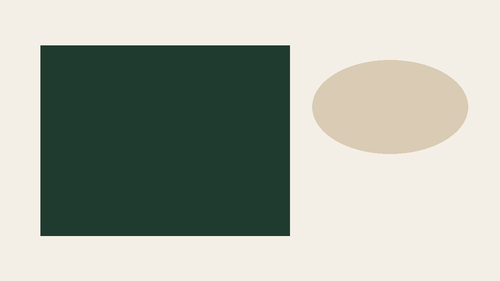

This page is a labelled template and a layout test. It shows how an article will look. It is not training advice, and it must stay a draft.

## What this page is for

Use it to check the design before a real article goes on the site. A finished article should be easy to read, with one clear idea and links to [Sanjeev's story](/about.html) and the [booking page](/book.html).

- Write the way you would speak to a new client.
- Check facts and numbers before you publish.
- Leave out medical claims and promises of results.

> Start with the person in front of you, then choose the simplest next step.

## A sample week

The table below is placeholder text for the layout. It is not a program to follow.

| Day | Focus | Note |
| --- | --- | --- |
| Monday | Strength | Two sets you can finish with calm form |
| Wednesday | Walk | An easy pace, long enough to feel warm |
| Friday | Strength | Repeat Monday if the last session felt steady |

### Strength days

Keep the sample weight light enough that the last reps still look like the first ones. This sentence is only here to show a smaller heading.

### Easy days

Walk, or repeat the same movements with little or no load. The point of this sample is the layout, not a result.

## How to use the template

Copy `_template.md`, rename the file so it matches the slug, and write in short paragraphs. When Sanjeev has approved the article, set the status to published, add his name as the reviewer, and add the date he approved it.

Build the site again after that. The article can then appear on the blog and on the home page.
